# DramaStream — Netflix-Inspired Streaming Site

A Netflix-style streaming catalog for **drama films, drama series and drama documentaries**, built for the Code Platoon Netflix Clone assignment and extended in four phases into a full-stack app: React + Vite + React Router on the front end, and **Supabase** (Postgres, Row Level Security, Auth, Edge Functions) behind it, with live search and details from the **TMDB API**.

> This is an educational, Netflix-inspired project. It is not affiliated with Netflix, and it streams no films or episodes: the player is a clearly labelled mock-up.

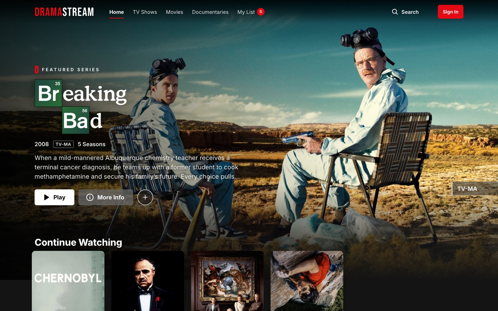

## Contents

- [Phases](#phases)
- [Features](#features)
- [Screenshots](#screenshots)
- [Catalog](#catalog)
- [Start the app](#start-the-app)
- [Tests](#tests)
- [Database (Supabase)](#database-supabase)
- [Edge Functions and TMDB](#edge-functions-and-tmdb)
- [Deploy](#deploy)
- [Routes](#routes)
- [Project structure](#project-structure)
- [Data and privacy](#data-and-privacy)
- [Artwork and sources](#artwork-and-sources)
- [Planning docs](#planning-docs)

## Phases

The work was planned in [`Plan/Tasks.md`](Plan/Tasks.md) as 75 tasks in 15 feature areas, tagged `phase-1` (do first), `phase-2` (next) and `phase-3` (nice to have). **73 of 75 are done.** Left: deploying (the config is ready, see [Deploy](#deploy)) and revoking a temporary CLI access token.

### Version 1: the front-end prototype (before the phases)

The original class assignment: a React SPA with 30 drama titles in three rows, search, title details, My List, ratings and reviews in the browser, sharing, and a mock player. See [`design.md`](design.md) and [`Plan/Plan.md`](Plan/Plan.md).

### Phase 1: a real backend and accounts

- **Catalog in Supabase:** titles, genres, people and credits, seasons and episodes, with public read-only Row Level Security. The site renders the bundled catalog immediately and swaps in the database copy, so it never goes blank if Supabase is unreachable.
- **Optional accounts** with Supabase Auth: sign up, sign in, sign out, password reset. There's a Netflix-style welcome page for first-time visitors, and an account menu in the header.
- **My List and Continue Watching** saved per account (in the browser for guests), with Resume and Start Over, progress bars, and **Remove from row**.
- Row arrows with a page indicator, and a header that turns solid on scroll.
- Accessibility audit (axe-core, WCAG 2.2 AA: no violations), unit tests, and Supabase security and performance advisors.

### Phase 2: Netflix parity

- **Profiles** ("Who's watching?"), up to 5 per account, including kids profiles limited by maturity level. My List, progress, ratings and reviews belong to the profile.
- **Home like Netflix:** Top 10 with big rank numbers, Trending Now and Top 10 from anonymous play/add counts, New Releases, Because you watched…, genre rows, a rotating billboard, and hover cards that expand after a short delay.
- **Title details as a modal** over the page you were on (shareable URL, Back/Escape closes, focus trapped), with a full page for direct links.
- **Seasons and episodes** for every series: 850 episodes, each with its still and a synopsis.
- **Player:** episode picker, playback speed, simulated volume and mute, full screen, Next Episode with an autoplay countdown, and F/M/↑/↓ shortcuts.
- **Search** by title, cast, director or genre; **Browse** pages for TV Shows, Movies and Documentaries with a genre filter.
- **Ratings** switched to Netflix's three options (Not for me / I like this / Love this!), saved per profile.
- **60 titles** (20 per row), responsive images (`srcset`), lazy-loaded pages, and deploy config.

### Phase 3: the extras

- **Mock plan step** (Basic / Standard / Premium, all free, no payment details) at sign-up and on Account.
- **Profile Lock:** an optional 4-digit PIN per profile.
- **Account page:** email, plan, profiles, viewing activity, and sign out of all devices.
- **Per-profile settings:** maturity level, preferred language, subtitle size and style, autoplay next episode, and autoplay previews.
- **New & Popular:** Coming Soon with **Remind Me**, New on DramaStream, and Top 10.
- **Notifications bell** for new arrivals and reminders that came true.
- **% Match** and a **Because you liked…** row, worked out from your own ratings.
- **Billboard preview:** an animated still with a (simulated) mute toggle.
- **Audio & Subtitles menu** in the player (mock tracks styled by the profile's subtitle settings).
- **My List sorting** (Date added, A–Z, Z–A, Release year).
- **End-to-end tests** with Playwright for the main journeys on desktop and phone.

### Phase 4: Edge Functions and live TMDB data

The Code Platoon serverless-functions and 3rd-party-API assignments, built into this app (details in [Edge Functions and TMDB](#edge-functions-and-tmdb)):

- **Supabase Edge Functions** (Deno): `hello-world` and `multiply-numbers` as the first exercises, then `tmdb-search` and `tmdb-details`.
- **Live TMDB search:** Search shows a **More from TMDB** section under the catalog matches, for titles we don't carry.
- **TMDB details page** (`/tmdb/:type/:id`): overview, genres, seasons or runtime, creator or director, and cast.
- The TMDB key lives only in a **Supabase secret**; the browser talks to our functions, never to TMDB directly.
- **Kids profiles never see TMDB content** (it has no DramaStream maturity rating, and unrated titles count as adult).

## Features

| Area | What you can do |
|---|---|
| Browse | Billboard, Continue Watching, Top 10, My List, Trending Now, New Releases, Because you watched / liked, genre rows, and the three category rows. Hover a poster for Play, My List, Rate, More Info, % Match, maturity, length and genres. |
| Details | Opens as a modal over the page; series show every season and episode with stills and synopses; More Like This; About; Remind Me for Coming Soon titles. |
| Trailers | A **Trailer** button on the details modal, the details page and the billboard plays the title's official YouTube trailer (privacy-enhanced `youtube-nocookie.com` embed) in an accessible dialog. Escape, Close or a click outside stops it and returns focus. 57 of 66 titles have one, Coming Soon included; the button is hidden for the 9 with no official trailer on TMDB. |
| Search & browse | Live search by title, actor, director or genre, accent- and punctuation-insensitive, with "Explore titles related to". TV Shows, Movies and Documentaries pages with a genre filter. |
| TMDB (live) | Search adds a **More from TMDB** section (titles we don't have, duplicates hidden), and each card opens a details page with overview, facts and cast. Hidden on Kids profiles. |
| New & Popular | Coming Soon with arrival dates and Remind Me, New on DramaStream, Top 10. The bell shows new arrivals and reminders. |
| Player | Mock playback (no video) with play/pause, seek, ±10 s, speed, simulated volume and mute, full screen, Skip Intro, Next Episode countdown, Audio & Subtitles, and Space/K, ←/→, F, M, ↑/↓. Saves where you stopped. |
| Accounts (optional) | Plan step, sign up/in/out, password reset, Who's watching?, up to 5 profiles (kids, maturity, PIN lock, language, subtitles, autoplay), Account and Viewing activity. |
| Lists & ratings | My List (sortable), Continue Watching, Not for me / I like this / Love this!, written reviews. Saved in the browser for guests, or per profile when signed in. |
| Quality | Responsive (phone tab bar), keyboard accessible, screen-reader announcements, reduced-motion support; no WCAG 2.2 AA violations in axe-core. |

## Screenshots

| | |
|---|---|
|  | 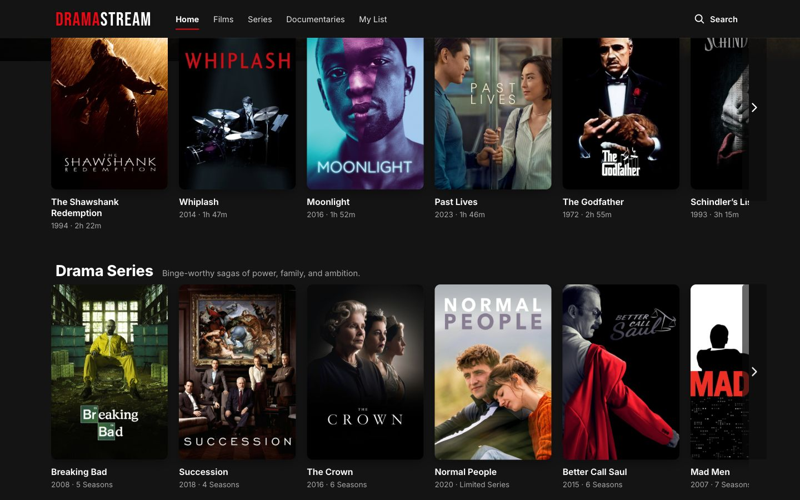 |
| **Home** | **Continue Watching and Top 10** |
| 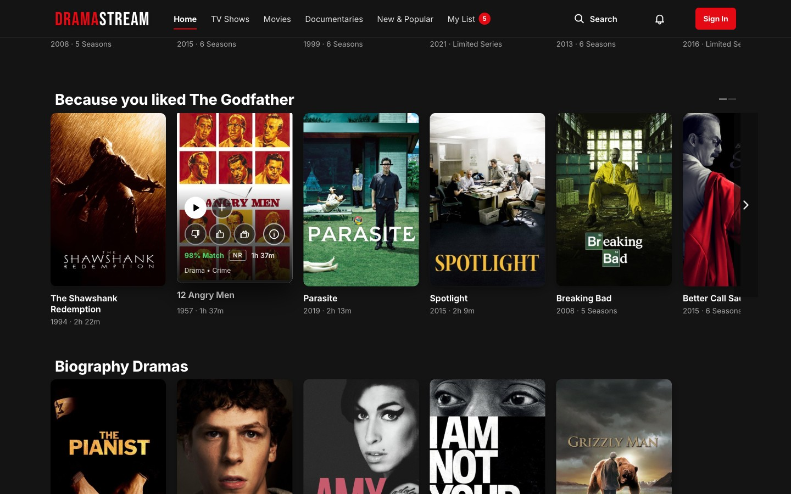 | 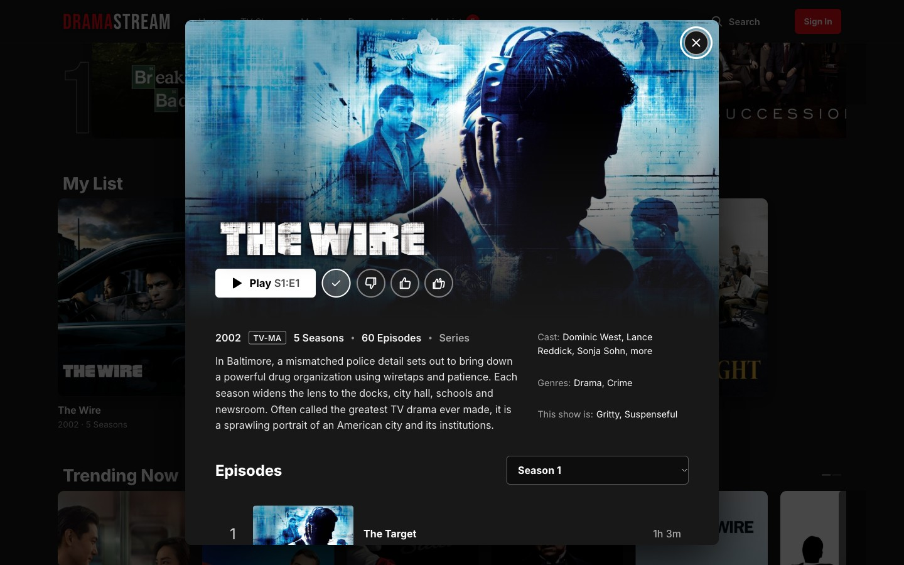 |
| **Hover card and % Match** | **Details modal** |
| 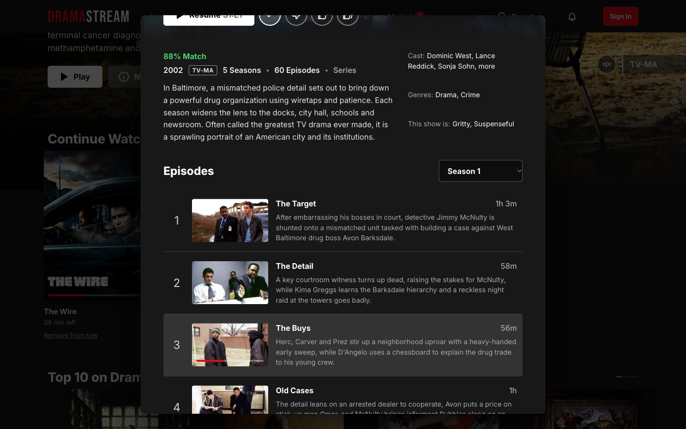 | 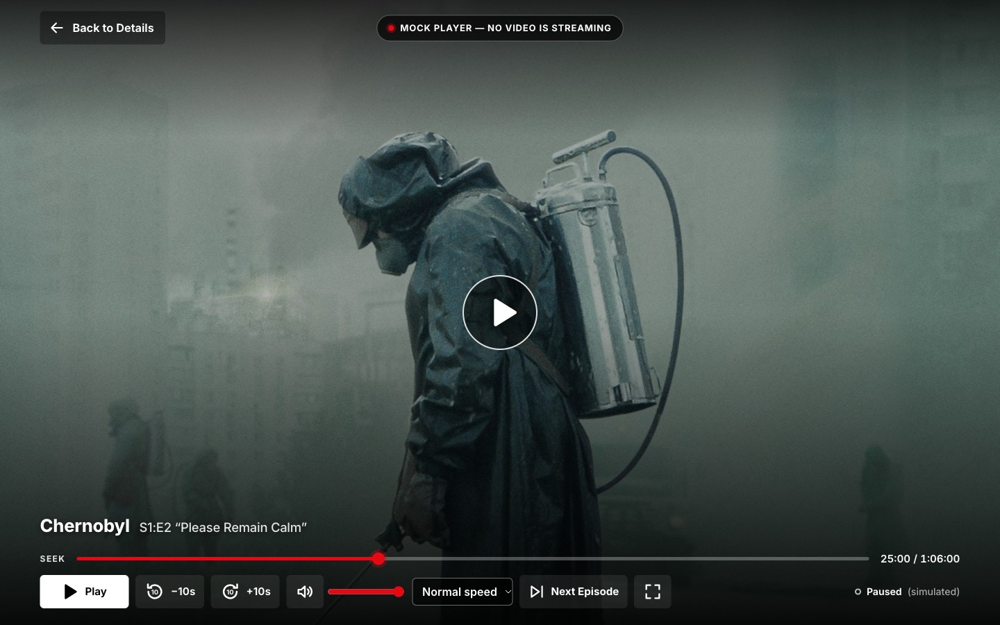 |
| **Episodes** | **Player: Audio & Subtitles** |
|  | 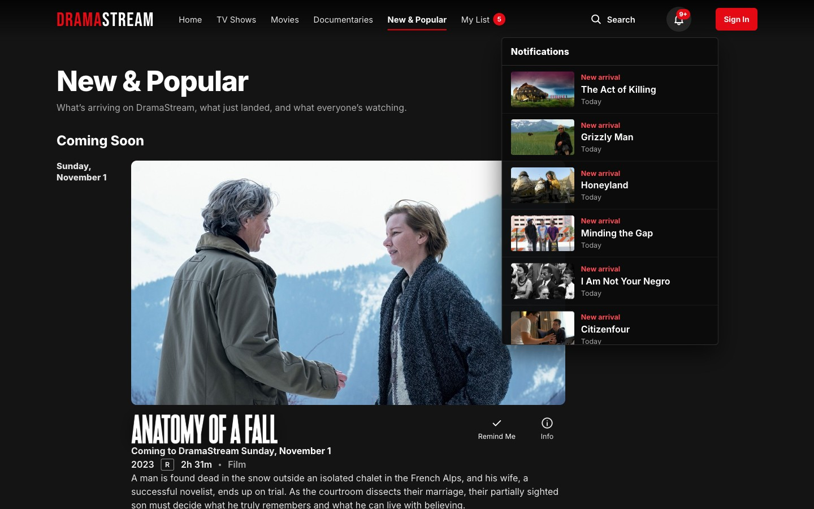 |
| **New & Popular** | **Notifications** |
| 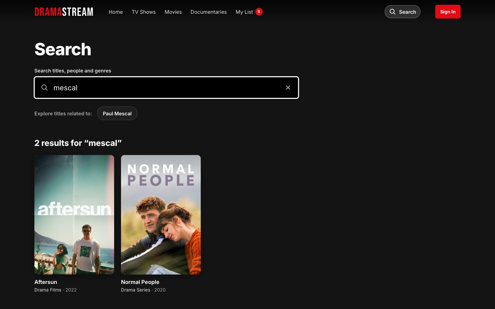 |  |
| **Search by person** | **Browse with a genre filter** |
|  |  |
| **Welcome page** | **Plan step** |
|  | 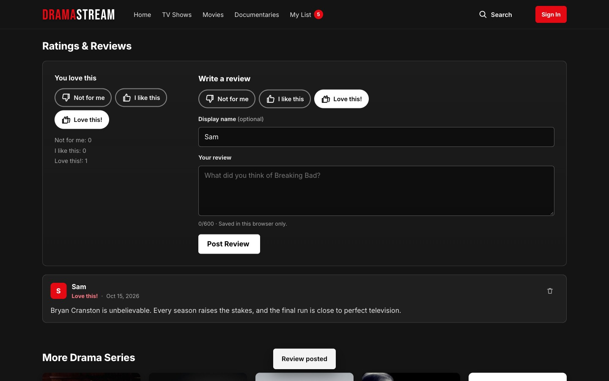 |
| **My List** | **Ratings & reviews** |
| 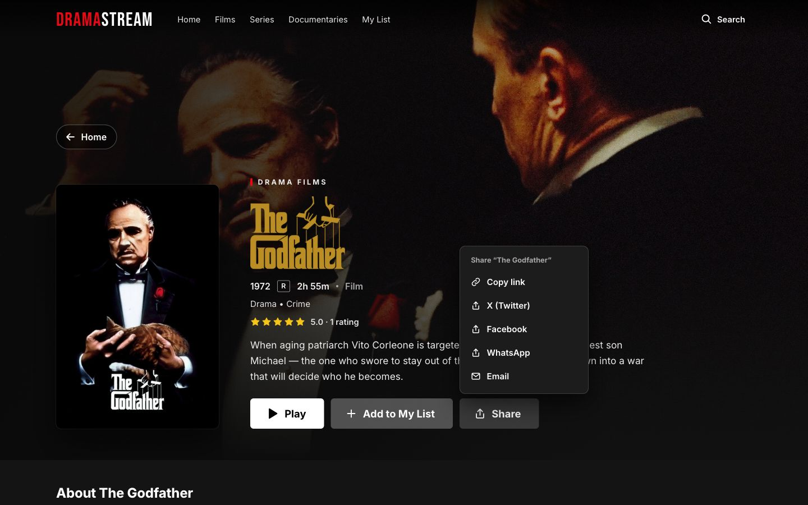 | 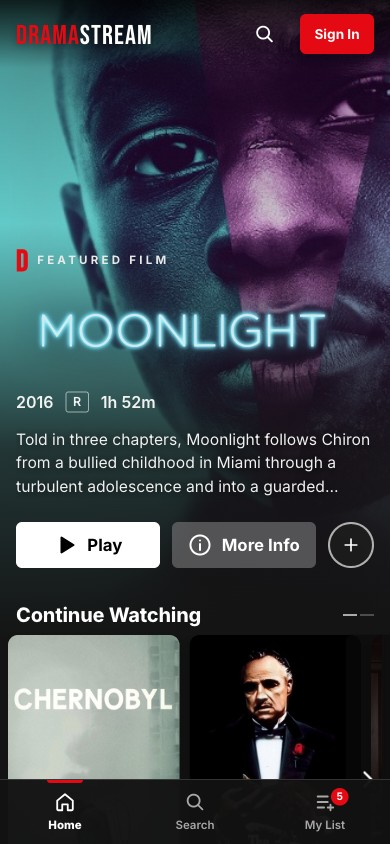 |
| **Share menu** | **Phone layout** |
| 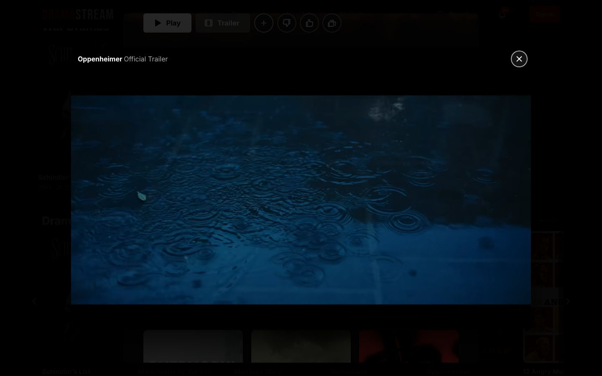 | |
| **Trailer player** | |

Screens that need a signed-in account (Who's watching?, profile settings, Account, Viewing activity) aren't pictured: the screenshots are taken signed out.

## Catalog

**60 titles**, 20 per row, plus **6 Coming Soon** titles. They load from Supabase, with the same data bundled in `src/data/catalog.js` as a fallback. **Breaking Bad** is the featured title. Every series lists all of its episodes in Supabase (850 in total, with stills and synopses); the bundled fallback only knows each series' first episode.

| Drama Films | Drama Series | Drama Documentaries |
|---|---|---|
| The Shawshank Redemption (1994, R) | **Breaking Bad** (2008, TV-MA) | Free Solo (2018, PG-13) |
| Whiplash (2014, R) | Succession (2018, TV-MA) | 13th (2016, TV-MA) |
| Moonlight (2016, R) | The Crown (2016, TV-MA) | My Octopus Teacher (2020, TV-PG) |
| Past Lives (2023, PG-13) | Normal People (2020, TV-MA) | Won’t You Be My Neighbor? (2018, PG-13) |
| The Godfather (1972, R) | Better Call Saul (2015, TV-MA) | Man on Wire (2008, PG-13) |
| Schindler’s List (1993, R) | Mad Men (2007, TV-14) | Searching for Sugar Man (2012, PG-13) |
| Manchester by the Sea (2016, R) | Chernobyl (2019, TV-MA) | Jiro Dreams of Sushi (2011, PG) |
| Marriage Story (2019, R) | The Sopranos (1999, TV-MA) | Icarus (2017, NR) |
| Nomadland (2021, R) | Mare of Easttown (2021, TV-MA) | Senna (2010, PG-13) |
| Oppenheimer (2023, R) | The Queen’s Gambit (2020, TV-MA) | American Factory (2019, NR) |
| 12 Angry Men (1957, NR) | The Wire (2002, TV-MA) | Hoop Dreams (1994, PG-13) |
| Parasite (2019, R) | Six Feet Under (2001, TV-MA) | Amy (2015, R) |
| The Pianist (2002, R) | Friday Night Lights (2006, TV-14) | Three Identical Strangers (2018, PG-13) |
| Room (2015, R) | The Leftovers (2014, TV-MA) | Blackfish (2013, PG-13) |
| Lady Bird (2017, R) | Band of Brothers (2001, TV-MA) | Citizenfour (2014, R) |
| The Social Network (2010, PG-13) | The Americans (2013, TV-MA) | I Am Not Your Negro (2017, R) |
| Spotlight (2015, R) | Halt and Catch Fire (2014, TV-14) | Minding the Gap (2018, NR) |
| Roma (2018, R) | Downton Abbey (2010, TV-14) | Honeyland (2019, NR) |
| Aftersun (2022, R) | Shōgun (2024, TV-MA) | Grizzly Man (2005, R) |
| Boyhood (2014, R) | The Night Of (2016, TV-MA) | The Act of Killing (2012, NR) |

### Coming Soon

Real, already-released titles, arriving on DramaStream on the site's own demo schedule. Each one leaves Coming Soon and appears in the rows automatically on its date.

| Title | Type | Year, rating | Arrives |
|---|---|---|---|
| Anatomy of a Fall | Film | 2023, R | 2026-11-01 |
| Slow Horses | Series | 2022, TV-MA | 2026-11-08 |
| Fire of Love | Documentary | 2022, PG | 2026-11-15 |
| The Pitt | Series | 2025, TV-MA | 2026-11-22 |
| The Zone of Interest | Film | 2023, PG-13 | 2026-11-29 |
| Summer of Soul | Documentary | 2021, PG-13 | 2026-12-06 |

Year, rating, runtime, seasons/episodes, credits and episode titles come from TMDB. Every synopsis — titles and episodes — was written for this project.

## Start the app

```bash
npm install
cp .env.example .env.local   # then fill in your Supabase URL and publishable key
npm run dev
```

Without `.env.local` the site still runs: it uses the bundled catalog, and account features are hidden.

```bash
npm run build      # production build in dist/
npm run preview    # serve the build
```

## Tests

```bash
npm test           # 52 unit tests (Vitest): catalog, search, rows, % Match, notifications, plans, PIN, validation, trailers, TMDB trimming
npm run test:e2e   # 24 end-to-end journeys (Playwright, desktop + phone)
```

The end-to-end tests start the dev server (or reuse one on port 5173). The first time, install the browser with `npx playwright install chromium`. They cover the welcome page, Home rows, the details modal, search, Browse, My List with sorting, ratings with % Match, Resume and Continue Watching, the Next Episode countdown, Coming Soon with Remind Me, the bell, the trailer player (with YouTube stubbed out, so the tests don't need it), the TMDB search section and details page (with the Edge Functions mocked, so no network or TMDB key is needed), and the phone layout.

## Database (Supabase)

Everything about the database lives in [`supabase/`](supabase/):

| File | What it holds |
|---|---|
| `catalog.sql` | Titles, genres, people, credits, seasons, episodes; public read-only RLS |
| `profiles.sql` | Profiles (≤ 5 per account), per-profile My List, viewing progress, ratings, reviews; owner-only RLS |
| `activity.sql` | Anonymous daily play/add counts for Top 10 and Trending (filled by triggers) |
| `phase3.sql` | PIN and subtitle settings, Coming Soon dates, reminders |
| `trailers.sql` | `titles.trailer_youtube_key` (official YouTube trailer per title) and its values; adds no policies, so titles stay read-only |
| `schema.sql` | The class's task-manager homework tables (not used by the site), with Supabase Auth: a `users` row per account (trigger), and own-rows-only RLS |
| `backups/` | CSV exports of the task-manager tables taken before the auth rebuild |
| `seed/` | Generators and data: `catalog.sql`, `episodes.json`/`episodes.sql`, and the TMDB research files (`trailers-research.json` lists each trailer's TMDB source and the titles without one) |

Signed-out visitors can only read the catalog. Everything personal is protected by Row Level Security so an account sees only its own profiles and their data. Supabase's security advisor reports no warnings.

## Edge Functions and TMDB

Four [Supabase Edge Functions](https://supabase.com/docs/guides/functions) live in [`supabase/functions/`](supabase/functions/). Each answers the browser's CORS preflight and returns JSON, with 400 for bad input and 502 when TMDB fails.

| Function | Call | Returns |
|---|---|---|
| `hello-world` | `GET` | `{"message":"Hello World"}` |
| `multiply-numbers` | `GET ?a=6&b=6` or `POST {"a":6,"b":6}` | `{"result":36}`; 400 if either is missing or not a number |
| `tmdb-search` | `POST {"q":"parasite"}` or `GET ?q=` | `{"results":[{id, type, title, year, overview, poster, rating}]}` (up to 12 films and series) |
| `tmdb-details` | `POST {"type":"tv","id":76331}` or `GET ?type=&id=` | `{"details":{title, overview, genres, runtime, seasons, directors, cast, …}}`; 404 if TMDB has no such title |

`supabase/functions/_shared/` holds the CORS headers and the TMDB auth helper. The functions are public demos, so `supabase/config.toml` sets `verify_jwt = false` for them (the new `sb_publishable_` keys are not JWTs).

**Keeping the TMDB key secret.** The key is a Supabase secret named `TMDB_API_KEY`, read in the functions with `Deno.env.get`. It is never in the source, never in a `VITE_` variable, and never sent to the browser. Either TMDB credential works: the short v3 API key or the long v4 read access token.

| Where | How |
|---|---|
| Deployed | Supabase dashboard → Edge Functions → Secrets, or `supabase secrets set TMDB_API_KEY=…` |
| Local functions | `supabase/functions/.env` (git-ignored; `.env` is in `.gitignore`) |

**Deploy the functions** (needs the [Supabase CLI](https://supabase.com/docs/guides/cli) and `supabase login`, or a `SUPABASE_ACCESS_TOKEN`):

```bash
supabase functions deploy tmdb-search  --project-ref YOUR_PROJECT_REF
supabase functions deploy tmdb-details --project-ref YOUR_PROJECT_REF
```

**In the app.** `src/data/tmdb.js` calls the functions with `supabase.functions.invoke`. On Search, a pause in typing (400 ms, two or more letters) triggers the TMDB lookup, titles already in the catalog are hidden from it, and if TMDB fails the catalog results still show. TMDB titles aren't in the catalog, so they can't be played or added to My List.

## Deploy

The app is a static single-page app; Supabase is the backend. Both Vercel and Netlify work. Every route falls back to `index.html` (`vercel.json` for Vercel, `public/_redirects` for Netlify).

1. Push the repo to GitHub.
2. **Vercel:** New Project → import the repo (it detects Vite: build `npm run build`, output `dist`). **Netlify:** Add new site → import the repo, build command `npm run build`, publish directory `dist`.
3. Add two environment variables with the same values as `.env.local`:
   - `VITE_SUPABASE_URL`
   - `VITE_SUPABASE_PUBLISHABLE_KEY` (the publishable key only, never the secret/service-role key)

   The TMDB key is **not** one of them: it stays in Supabase secrets (see [Edge Functions and TMDB](#edge-functions-and-tmdb)).
4. Deploy, then in Supabase → **Authentication → URL Configuration**:
   - set **Site URL** to the deployed address;
   - add `https://YOUR-SITE/**` to **Redirect URLs**, so sign-up confirmation and password-reset links come back to the site.
5. Real visitors only get sign-up emails once you add your own SMTP under **Authentication → Emails** (Supabase's built-in sender only mails your team).

After adding artwork, run `sh scripts/make-image-sizes.sh` (macOS) to create the smaller copies the site serves on small screens.

## Routes

| Route | Screen |
|---|---|
| `/` | Home (`/#drama-films`, `/#drama-series`, `/#drama-documentaries` jump to a row) |
| `/browse/series`, `/browse/films`, `/browse/documentaries` | TV Shows, Movies, Documentaries (`?genre=` filter) |
| `/new` | New & Popular: Coming Soon, New on DramaStream, Top 10 |
| `/search?q=` | Search |
| `/titles/:titleId` | Title details: a modal when opened in the app, a full page for direct links |
| `/tmdb/:type/:tmdbId` | TMDB details for a title we don't carry (`type` is `movie` or `tv`; not shown to Kids profiles) |
| `/my-list` | My List |
| `/watch/:titleId` | Mock player (resumes; `?s=&e=` picks an episode, `?t=0` starts over) |
| `/welcome` | Signed-out welcome page (first visit) |
| `/signin`, `/signup` | Sign in; plan step + sign up |
| `/forgot-password`, `/reset-password` | Password reset |
| `/profiles`, `/profiles/new`, `/profiles/:id/edit` | Who's watching? and profile settings (signed in) |
| `/account`, `/account/activity` | Account and Viewing activity (signed in) |
| `/help` | FAQ |
| `*` | Not Found |

## Project structure

```text
src/
  app/          App.jsx (routes, modal route, profile gate), RouteEffects.jsx (scroll & focus)
  components/   AppHeader, AccountMenu, NotificationsBell, FeaturedTitle, TitleRow, TitleCard,
                TitleModal, EpisodeList, MockPlayer, AudioSubtitlesMenu, ThumbsRating, ReviewsSection,
                PlanPicker, PinDialog, ProfileAvatar, RemindButton, AuthShell, SearchForm, TmdbCard, …
  data/         catalog.js (bundled catalog, maturity + Coming Soon filters, search), remoteCatalog.js,
                rows.js (Home rows), match.js (% Match), notifications.js, activity.js, billboard.js,
                moods.js, plans.js, tmdb.js (TMDB search and details through the Edge Functions)
  lib/          supabase.js (client), storage.js, validate.js, pin.js, guest.js
  pages/        Home, Browse, NewPopular, Search, TitleDetails, TmdbDetails, MyList, Player, Landing, SignIn, SignUp,
                ForgotPassword, ResetPassword, Profiles, ProfileEdit, Account, Activity, Help, NotFound
  state/        Auth, Profile, MyList, Progress, Reviews, Reminders, Status (toasts) contexts
  styles/       global.css, components.css, account.css
  __tests__/    Vitest unit tests
e2e/            Playwright end-to-end tests
supabase/       schema files, seeds and research data (see Database)
supabase/functions/  Edge Functions: hello-world, multiply-numbers, tmdb-search, tmdb-details, _shared/
public/assets/  posters/ (+400/), hero/ (+960/), logos/, stills/, CREDITS.md
scripts/        make-image-sizes.sh
docs/screenshots/
```

## Data and privacy

- **Catalog:** public, read-only, from Supabase (or the bundled copy).
- **Signed out:** My List, Continue Watching, ratings, reviews and reminders are saved only in this browser's `localStorage`.
- **Signed in:** they belong to the chosen profile in Supabase and are visible only to that account (Row Level Security). Anything saved before signing in moves into the first profile you pick.
- **Accounts** store an email address (plus Supabase's hashed password) and the mock plan name. No payment details, ever. Profile PINs are stored only as salted hashes.
- **Top 10 / Trending** use anonymous per-title counts with no user or profile ids.
- **TMDB search:** the text you type is sent to TMDB through our Edge Function (never with your account details), and the TMDB key never reaches the browser. Kids profiles don't get TMDB content.
- **Share** only opens links you choose; nothing is posted automatically.

## Artwork and sources

Posters, backgrounds, logos and episode stills were downloaded once from TMDB's image CDN for this educational project and are listed in [`public/assets/CREDITS.md`](public/assets/CREDITS.md). Titles found through live TMDB search load their posters and cast photos straight from TMDB's image CDN. This product uses the TMDB API but is not endorsed or certified by TMDB. Every image falls back to a neutral placeholder if it fails to load. Smaller copies (`posters/400/`, `hero/960/`) come from `scripts/make-image-sizes.sh`.

## Planning docs

- [`Plan/Tasks.md`](Plan/Tasks.md): the 75-task checklist, by feature area and phase.
- [`Plan/Plan.md`](Plan/Plan.md): planning questions, user stories and decisions.
- [`design.md`](design.md): the original product plan and acceptance criteria.
- [`app_outline/`](app_outline/) and [`supabase/`](supabase/): the Databases & Supabase class homework (task-manager spec and database).
